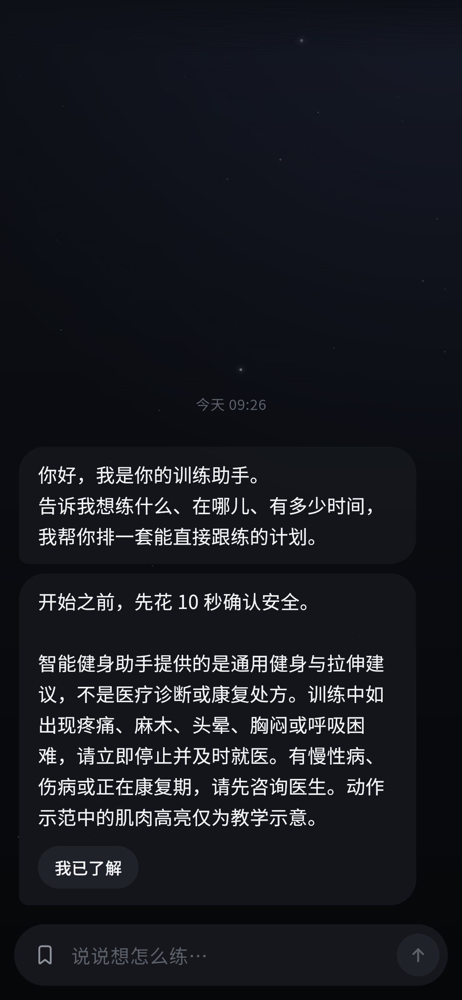
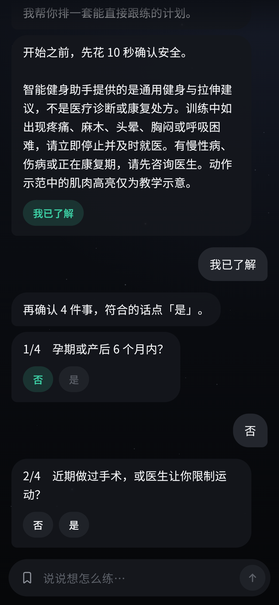
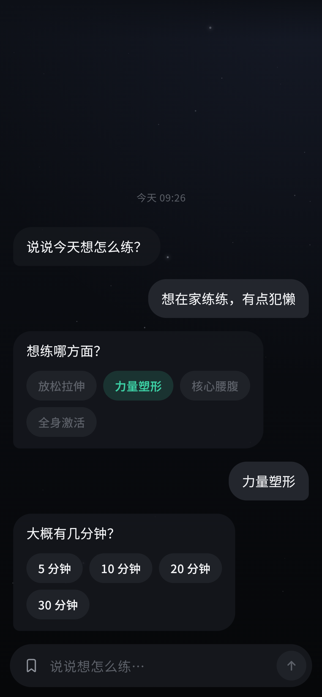
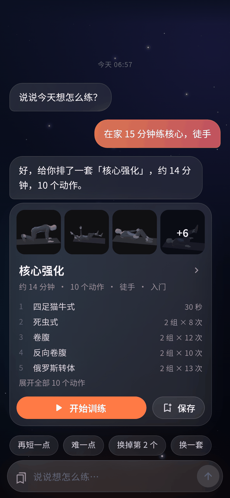
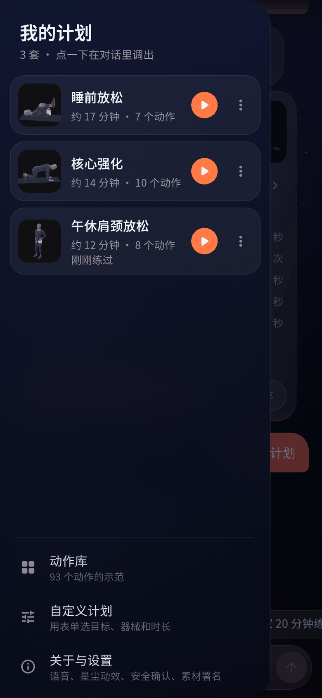
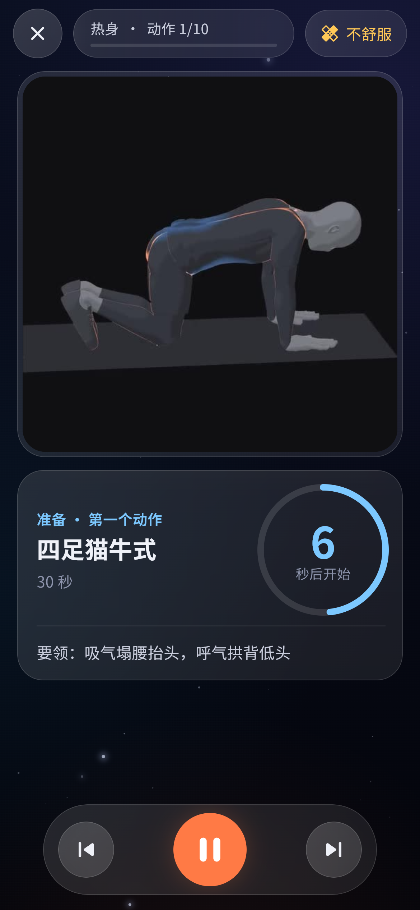
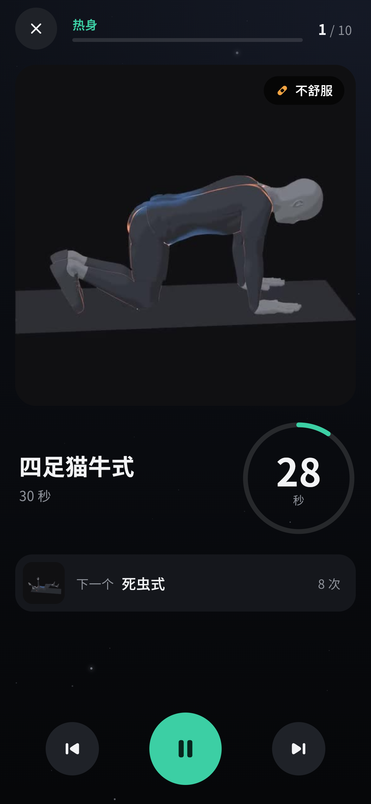
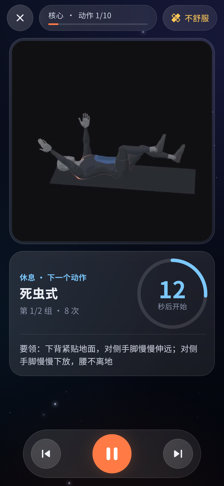
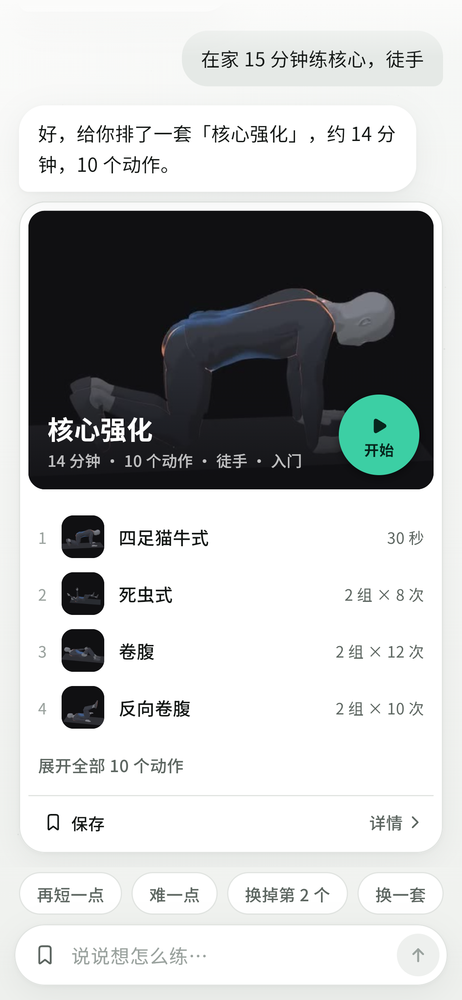
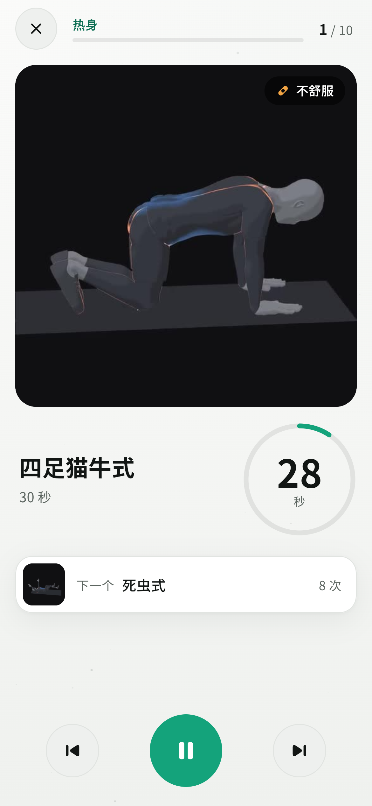

# 对话式主界面

当前 main 为 `0.1.0+9`，已通过 [PR #4](pr4-local-review.md) 合入 Liquid Glass：输入栏与建议浮动在对话上方，紧凑计划卡原地展开，展开后保存；开始训练仍交给共享 SDK。237 项测试与实际浏览器深浅色交互通过。新对话、取消/进度、门禁动作/计划卡和 AI 记忆保留。下面 `+8` 的说明和旧截图属于 SDK 接入阶段，当前 UI 以 PR #4 的截图与验证为准。

主界面只有一段对话：漂在无边的空间里（默认跟随系统，可切换深空或浅色「白色无边空间」，保留已有外观选择），没有标题栏和边框。视觉规范见 [design-language.md](design-language.md)。助手可回复文字、动作卡或计划卡：动作卡点开详情，计划卡可开练或保存。SDK 接入阶段的 `0.1.0+8` 使用 SDK 0.3.2，2026-10-21 经开哥授权合入 `ebb0840`，已推送 origin/main 并核对远端一致。旧 `+7` 功能随本次进入主线，旧证据不替代本轮独立验证。AI 最终失败使用「预设方案」。

当前里程碑与验收边界见 [版本管理与台账](version-management.md)。可以直接说「看看动作库」「上次练了什么」「换浅色」「关闭语音」「设置」「重新安全确认」或「自己选条件」；抽屉仅保留已存计划、动作库与设置。这些本地操作和安全门禁优先于 AI，不把模型回复直接当成操作指令。下方截图保留原对话首页的视觉记录，不是本次 AI 真机证据。

| 开场对话 | 安全确认 | 追问 | 计划卡片 | 已存计划抽屉 |
|---|---|---|---|---|
|  |  |  |  |  |

## 结构

```
lib/chat/chat_models.dart      ChatMessage / ChatOption / Slots / ChatState / ChatReply + ChatEngine 接口
lib/chat/slot_parser.dart      槽位解析（目标、场景、器械、时长、水平、部位、需保护部位）+ 改计划意图
lib/chat/rule_chat_engine.dart RuleChatEngine：追问 → 选模板 → TemplatePlanGenerator → PlanValidator；改计划；已存计划
lib/chat/ai_chat_engine.dart   长期持有 CoachAgent；typed 工具结果、进度事件、本地回落、取消/reset、持久化卡片恢复重验
lib/chat/ai_coach_config.dart  Worker 地址、模型、X-App-Key / X-Device-Id 鉴权（无 Authorization）
lib/app/device_identity.dart   本机随机 UUIDv4；持久化成功后才返回，供 Worker 限流
lib/app/user_memory_store.dart App 实现 UserMemoryStore.load/save，独立本机记忆键
lib/data/app_store.dart        AI 记忆开关及其他本机设置、聊天、计划、训练结果
lib/chat/chat_controller.dart  会话状态、开场安全确认、保存/开始/练完、历史（AppStore，最近 60 条）
lib/chat/safety_script.dart    免责声明 + 4 个安全问题 + 各自建议（含义与原安全页一致）
lib/ui/chat/                   cosmos（背景）、chat_widgets（气泡/选项/输入框/建议）、action_card、validated_plan_card、plan_card、saved_plans_drawer、expand_route
lib/ui/theme/                  设计 token（颜色/字号/间距/圆角/动效）、Material 主题与 SfPaletteScope、图标、按钮金字塔
```

## AI 接入（0.1.0+8 / SDK 0.3.2，核心已验，已合入并推送 main）

`ugk_coach 0.3.2` 与 `ugk_trainer 0.1.4` 的 git ref 均固定 SDK main `b26e4fda807b6ef3db15a61ba30c67fb51dce5e1`。保留 `CoachAgent`、`CoachTurnResult` 和 typed 卡片边界；Agent 读 skill、核对后交付 `show_actions/show_plan`。默认最多 100 逻辑步，同一步重试不占新步骤；`CallOutcome` 没有新增枚举，重试记录使用 `UsageRecord.retry`。BaseURL、模型及鉴权仍为 `https://api.uuugk.win/v1`、`deepseek-v4-flash-0731`、`X-App-Key/X-Device-Id`，App Key 仅经 dart-define 注入，无 Authorization。

`AiChatEngine` 长期持有 Agent；关闭界面保留会话，「新对话」取消并 reset，作废结果不回写。请求中禁用发送、保留取消入口，`cancelled` 不显示。`reading/checking` 显示查库/核对计划；`retrying` 显示「网络不稳，正在重试（n/max）…」，上下文过长的 1/1 特例显示「正在整理上下文，继续思考…」；`slow` 显示「还在想…」。SDK 单次请求 60 秒、整轮 360 秒、每步最多 4 次重试，30 秒发慢提示；客户端 `maxRetries=0` 避免双层重试，App 外保护 390 秒，门禁最多重交 2 次。

纯文字只使用 SDK 接纳后的文字结果显示气泡；动作卡只接 `ValidatedActions`，计划卡只接 `ValidatedPlan`，保存、恢复和交给 `ugk_trainer` 的边界保持不变。模型原始输出、未接纳工具参数与中间读取结果不进入渲染层；恢复持久化卡片时重新过 SDK 门禁。失败仍回落本地模板并标「预设方案」，回落计划也要通过 `admitTemplate`。每轮 `CoachContext` 继续传入用户水平、时长、保护部位及场景/器械；AI 动作目录仍为实际随包 93 个动作。

App 实现 `LocalUserMemoryStore`，以 `load/save` 整表读写独立本机键 `smartfit.ai-memory.v1`；`enableUserMemory` 默认开启，开关持久化并即时同步 Agent。SDK 每条记忆工具等待真正保存成功才确认；已确认事实在后续取消/reset 时保留，未确认的迟到写入按 SDK 契约补偿。关闭保留原记忆；清除等待 `clearMemory()`，保存失败会抛错，成功后复读存储确认已空才提示成功。

开关和清除均保留当前聊天与已保存计划。当前对话已明确说过的条件仍属于对话上下文，因此验证关闭后不再引用本机记忆时，要先开「新对话」隔离旧消息和 App 已解析条件；新对话本身不删除本机记忆。记忆开启时摘要随请求上传；普通 App 操作、已存计划列表和训练历史仍不自动上传。UUID 保持独立键 `smartfit.device-id.v1`，不随清除记忆改变。

最终失败按重试用尽、不可重试、整轮超时或空转显示不同「预设方案」提示，异常与原始输出不进 UI。SDK 0.3.2 已在 main，App 不 patch SDK。App `b39304488e964b22a65501363a15140b5d0ca235` 的 224 项测试、分析、锁文件及 debug 构建通过。六条新交互均 ok、无回落，显式动作卡独立严格补验也通过。原臀桥合法文字导致的脚本无卡断言失败 / exit 1 保留，不称原脚本全通过。完整记录见 [0.3.2 验证](coach-032-smoke-2026-10-21.md)，旧 `+7` 仅属 [历史](coach-agent-smoke-2026-10-21.md)。

## 上一阶段 AI 接入（0.1.0+6 工具会话，历史）

以下保留 `+6` 的接口、超时与验收记录，不代表 `+7` 的当前实现或验证结果。

`ugk_coach 0.2.0` 与 `ugk_trainer 0.1.4` 通过 git 依赖共同固定到 SDK main commit `09a392bc0b736e6a23eef71d55d86108660e0e59`。入口改为 `CoachSession.send()`，不再使用旧版 `CoachAssistant.ask()` JSON 信封路线。BaseURL 为 `https://api.uuugk.win/v1`，模型 `deepseek-v4-flash-0731`；App Key 只通过 `--dart-define=SMARTFIT_AI_TOKEN` 注入。SDK `UgkWorkerAuth` 发送 `X-App-Key` 和持久化 UUID 的 `X-Device-Id`，不发送 `Authorization`。

纯文字结果按气泡显示；`show_actions` 只将 `ValidatedActions` 交给 `ActionCard`，动作名称、媒体和详情入口从本地动作库按已验证 id 解析。`show_plan` 只将 `ValidatedPlan` 交给 `ValidatedPlanCard`，再适配同一 TrainingPlan v1 保存或交给 `ugk_trainer` 开练。模型原始响应、工具参数和未通过门禁的内容不进入渲染层。已保存展示历史恢复为卡片前重新过 SDK 门禁，无法接纳的卡片不恢复。

App 生命周期内长期持有一个 `CoachSession`，关闭 AI 界面不清空；「新对话」取消当前请求并调用 `reset()`，旧轮晚到也不会写回新会话。发送期间禁用发送按钮，SDK 对重复发送立即返回 `busy`，不排队。等待态说明首轮计划可能需要 75–120 秒，并提供取消入口；`cancelled` 结果不显示。配置为单次 HTTP 超时 120 秒、HTTP 重试 0 次；门禁可要求模型最多重交 2 次，即最多 3 次提交，整轮保护超时 365 秒。

每轮 `CoachContext` 传入已知的用户水平 `level`、时长 `minutes`、保护部位 `avoid`，以及场景、器械等条件。明确给出的水平和时长是门禁硬约束，计划不一致时要求模型重交。断网、超时、限流或门禁最终失败使用原有 `RuleChatEngine` / `TemplatePlanGenerator`，回复和计划标「预设方案」；模板计划也经 SDK `admitTemplate`，不合格时不显示计划卡。每设备 30 次 / 10 分钟的限制由服务器执行，429 不在 HTTP 层自动重试。

随包 `assets/coach/smartfit.json` 与 SDK `09a392b` 的 `profiles/smartfit.json` 一致，其 `notes` 提及全目录 142 动作及 49 个未带素材的动作。该备注不表示 App 已加载 142 动作：`AppServices.loadContent()` 使用 SDK `DrillPackAdapter` 从实际 `PackSet.exercises` 构造 AI 目录，当前只注入随包 93 个动作，工具 schema 和门禁都使用这份目录。

模型请求包含当前输入、本轮训练条件、用户明确采用的当前计划和该 `CoachSession` 的历史（含已接纳工具调用与门禁反馈）；本地控制消息不充当模型历史，已存计划和训练历史不自动上传。本机随机设备 UUIDv4 使用独立键 `smartfit.device-id.v1`，首次持久化成功后才用于 AI 请求，存储失败使用本地引擎。构建配置见 [README](../README.md#构建)。本次不修改 SDK 代码，也不修改 pub 缓存。

`+6` 的分析、测试与模拟器 Worker 冷烟结果以 [验收记录](acceptance.md) 为准，本文不预先标记通过。本轮没有真机验收结果，旧包真机记录不代替本次工具会话验证；2026-10-21 已经开哥授权合入 `main`（`f83642e`）。

## 旧 AI 接入记录（0.1.0+5 / +4，历史）

旧 `feat/smartfit-ai-replies` / `+5` 使用 `ugk_coach 0.1` JSON 信封接口，不同于 `+6` 工具会话和当前 `+7` Skill Agent 实现。`+5` 源码为 `e549e0f84aa9118ef20752b8926c7b8c602a7e0f`，6 项接口/UUID/鉴权配置测试及分析通过；旧源全量 180 项此前通过，该轮未重跑。debug 包已保留数据覆盖安装。新地址实机通用问答通过（27,722 ms，1 次 HTTP 请求）；三次计划请求分别等待 43,447 / 41,589 / 41,952 ms 后均因 `all upstreams failed (tencent:AbortError)` 回退本地，第三次已简化为 3 动作 / 3 分钟。用户确认服务调整完成后重试仍发生，已显示本地模板提示且继续可用，新接口计划生成未通过。服务器 30 次 / 10 分钟配额未实际刷到第 31 次，仅自动化覆盖 429 不重试与提示。

`+5` 实际界面另已保存旧 `+4` 接口生成的「办公室肩颈放松」10 动作原始 AI 计划，从原卡进入 `ugk_trainer`，视频/倒计时正常，暂停后于 34 活动秒提前结束；重启后计划与部分训练结果保留，设备标识未变，前台服务已释放。请求通过调试 VM 延时调用真实 `ChatController`，由界面确认回复/卡片；保存、开练、暂停、结束均为实际 UI 点击。完整记录见 [验收记录](acceptance.md)，这次局部流程不代表新地址 AI 计划链路通过。

旧 `0.1.0+4` / `cc16f530944cf4f6034365aa111528536978ecc3` 的分析及 180 项测试通过；旧地址实机曾约 21 秒成功生成 AI 计划，随后追问回落本地。上述旧记录不代替 `+6` 或 `+7` 的独立验收；`+5` 阶段未合 main 或推送。

## 本地操作与预设方案规则（RuleChatEngine）

以下追问次数和模板编辑规则描述本地引擎；AI 正常可用时，训练问答与工具选择由 `CoachAgent` 处理。本地 App 操作和安全回答仍优先处理。

- 信息不足时短句追问，最多两问，带可点选项：想练哪方面？→ 大概几分钟？→（力量/全身/核心且在家时）有哑铃或弹力带吗？问满两次仍缺的按默认（徒手）并在回复里说明。热身/拉伸不问时长。
- 一句话说全（「在办公室午休 10 分钟，肩颈很僵」）直接出卡片。
- 改计划：再短一点 / 长一点 / 改成 N 分钟；简单点 / 难一点（入门↔基础↔进阶）；换掉第 N 个 / 换掉<动作名> / 换一个（反问哪个）；换一套。卡片后补一句「有哑铃」「在家」「膝盖疼」会按新条件重排。
- 复用：上次那个 / 老样子（最近开始训练的计划，否则最近用过的已存计划）；我的计划（列出已存计划，点选调出）。
- 安全：开场 4 问任一「是」→ 给出对应就医/停止建议，不生成计划，只开放动作库；说到胸闷、头晕、心慌等 → 建议停止并就医；提到某部位疼 → 避开相关动作并提醒持续疼痛先就医。可在「关于与设置」重新确认。
- 无关闲聊 → 「这个我帮不上忙，我只负责帮你安排训练」+ 建议，不假装闲聊。

## 开始训练：卡片展开成跟练页

| 跟练 · 准备 | 跟练 · 训练中 | 跟练 · 休息 | 浅色 · 卡片 | 浅色 · 跟练 |
|---|---|---|---|---|
|  |  |  |  |  |

- 计划卡片封面上的「开始」圆盘、抽屉里已存计划的 ▶：`CardExpandRoute`（`lib/ui/chat/expand_route.dart`）做容器变换——卡片 500 ms 内放大到全屏（`fastOutSlowIn`），先铺天空底色，跟练页按全屏尺寸布局后随卡片宽度缩放并淡入（中途不重排），背后的对话只变暗不缩放。返回 420 ms 收回卡片当前位置；从抽屉开始的（抽屉已关）收回到对话中间。系统「减少动画 / 移除动画」时只淡入淡出。路由展开后不透明，对话页（含星尘）停止绘制。
- 跟练页（`PlayerPage`）结构参照 HipLab 训练页：顶栏关闭 · 区块名 + 进度条 · n/N；视频直接放在与渲染底一致的舞台上（不加模糊、不加色、不再套玻璃框），左上「已暂停 / 换左侧」、右上「不舒服」标签；动作名、组次与剂量、计时环（训练中强调色，准备/休息中性色）、要领；训练中下方显示「下一个」；底部上一个 / 暂停（全页唯一强调色圆盘）/ 跳过。完成页、不舒服面板、结束确认框同一套 token。计时、语音时序、视频播放与左右镜像、中断恢复、记录逻辑都没改。

## 视觉与性能

- 背景：两色天空渐变 + 一团极淡冷光 + 48 颗微尘缓慢上漂（CustomPainter，独立图层，≤30 fps）。App 进入后台、被其他页面覆盖（跟练中）、系统「减少动画」、或「关于与设置 → 星尘动效」关闭时停止。
- 气泡与卡片：色调分层，不再使用 `BackdropFilter`（上一版每个气泡一次背景模糊），绘制更省。
- 字体：内置 Noto Sans SC 可变字重子集（4.1 MB，OFL），真机与截图字重一致。

## 本轮核心验证

`+8` 的六条新交互均 ok、无回落，真实覆盖重试恢复、slow、记忆持久化与隔离；独立 show_actions 严格补验 4 步、72.908 秒通过，App 接收原准入动作对象，未误交付计划。原六条脚本的臀桥无卡断言失败及 exit 1 如实保留。2026-10-21 开哥授权以 `ebb0840` 合 main，合并树等于审核分支 `f0ebafc`，运行源码、测试和 APK 保持 `b393044`，本次未重跑；已推送 origin/main 并核对远端一致。完整指标见 [0.3.2 验证记录](coach-032-smoke-2026-10-21.md)。
