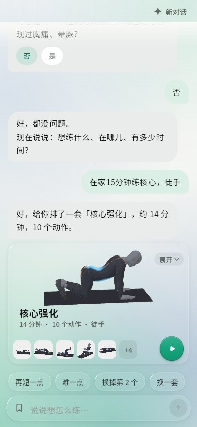
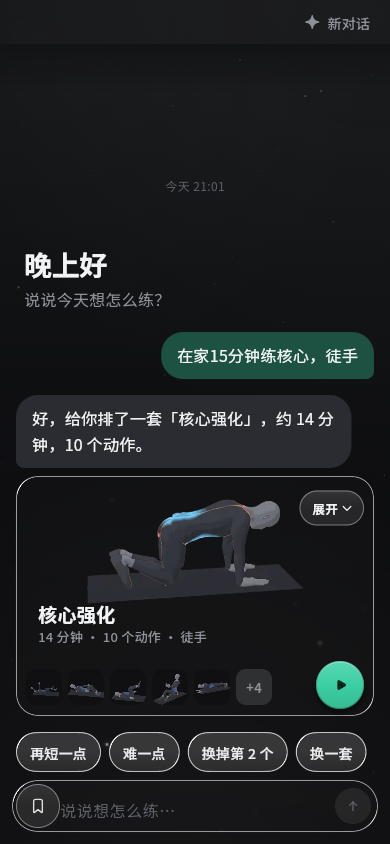

# PR #4 本机审核记录（2026-10-21）

审核对象：[Liquid Glass 聊天首页与计划卡片改版（深浅色）](https://github.com/mhgd3250905/Sport-Helper/pull/4)。用户明确授权审核并合并。完成冲突处理和下述修复后，本次 AI 结论为可合并；未向 GitHub 提交独立 review 或评论，平台合并状态以 PR 为准。

最终结果：PR 状态已核对为 MERGED，最终 head `67d1a731281ea5b865e6d5fd2fb2253e0a464795`、目标基线 `530686e224adf34d1e748cde35b4fb5575d6fe3d`，GitHub 合并提交 `561ea8cc69efa38d07c03169c257e8fa4116bc72`。本地主线已快进同步，合并整个树等于最终 PR head；本次后续只同步文档台账，运行代码和上述 APK 不变。

## 固定版本

| 项目 | SHA / 状态 |
| --- | --- |
| 最初 PR head | `d92f89ac2bed8405bd0cd664c2bc18e1e75e1e5e`，`feat/liquid-glass` |
| 检查时目标 main | `530686e224adf34d1e748cde35b4fb5575d6fe3d` |
| PR 报告的 baseRefOid | 同上；另外独立读取目标分支 ref 确认，未用 baseRefOid 推断最新 main |
| 原比较的 merge-base | `7ef80d75331a150b6a258ef3ba0c27832fd1e54b` |
| 集成后已测运行源码 | `829381ffa19b737a6c146c8c73b33394937665b1`；原 PR 与上述 main 的合并提交，含冲突处理、回归修复和版本 `0.1.0+9` |
| GitHub 原状态 | OPEN、非 draft、CONFLICTING/DIRTY，无 CI 检查记录，reviewDecision 为空；不能当作 CI 已通过或已有批准 |

验证使用独立副本 `Sport-Helper-pr4-review`，主项目工作目录保留在 main。没有修改 SDK 仓库或 pub 缓存，两项 SDK 依赖仍固定 `b26e4fda807b6ef3db15a61ba30c67fb51dce5e1`。

## 查实并处理的问题

1. **旧基线与当前 SDK 集成不兼容。** 六处文件冲突；直接保留旧 PR 的聊天和播放器实现会丢失新对话、取消/进度、`ValidatedActions` / `ValidatedPlan` 边界，以及共享训练播放器。以 main 业务逻辑为基线整合玻璃布局，保留 `CoachAgent` 和所有 `TrainerPlayer` 参数、语音、媒体、通知及结果持久化。播放器只在 App 外层增加静态色场；旧本地播放器的玻璃控件原型没有搬回，也没有复制或 patch SDK。新玻璃质量设置写入继续使用 main 的统一存储队列。
2. **P2：大字体下单动作卡溢出。** 原 PR `lib/ui/chat/plan_card.dart:214` 固定 130px 高、`:763` 预览随卡高伸宽、`:827` 标签固定 22px。在 320px 视口，字体 1.3 倍真实溢出 2px，2.0 倍溢出 42px。仅大字体时提高单动作卡高度，固定预览宽度并适配标签行高；普通字体的 130/240px 设计和折叠时间线保留。新增回归验证放大字体后开始、展开和保存仍可用。
3. 两个旧聊天测试按新交互先展开再保存，原有门禁、AI 说明、替换后训练快照及原保存计划不变等断言保留。

玻璃依赖精确固定 `liquid_glass_widgets 1.14.0`。核查其本地源码确认亮度解析使用玻璃控件自身的 context，显式 quality 仍受自适应上限约束，系统减少动效/高对比度设置仍被读取。代码检查未查实其他阻断项。

## 执行的验证

| 验证 | 结果 / 证据 |
| --- | --- |
| 依赖 | `flutter pub get --enforce-lockfile` 通过，SDK 版本仍为 coach 0.3.2 / trainer 0.1.4 |
| 全量测试 | `flutter test --no-pub`，237 项全部通过；`.buildlog/pr4-tests-final.log` |
| 静态分析 | `flutter analyze --no-pub`，0 issue；`.buildlog/pr4-analyze-final.log` |
| 大字体复现 / 修复 | `.buildlog/pr4-card-textscale-before.log` / `pr4-card-textscale-after.log`；修复前失败、修复后目标文件 5 项通过 |
| 主线集成回归 | `.buildlog/pr4-integration-tests.log`；存储队列两个写入顺序、训练结果与 AI 设置保留；390×844 + 320px 键盘时进度、取消、新对话可操作，迟到回复不覆盖新会话 |
| 聊天卡交互 | `.buildlog/pr4-chat-card-interactions.log`，两个文件 14 项通过 |
| Web 构建 | `flutter build web --no-pub --no-web-resources-cdn` 通过；`.buildlog/pr4-web-build.log` |
| 浏览器实测 | 实际 main 入口，390×844，加载正式玻璃着色器；安全流程、计划生成、展开、保存、进入 SDK 播放器、暂停/提前结束并返回、设置切深色、新对话及深色展开/保存通过；控制台 0 errors / 0 warnings |
| Android debug | 构建通过；`.buildlog/pr4-android-debug-build.log` |

浏览器使用本地模板和独立测试 origin，不把它记为新的真实 Worker 问答或 Android 真机体验。coach 请求、鉴权和记忆实现相对目标 main 未变；先前 SDK 0.3.2 的真实 Worker 数据保留在 [对应报告](coach-032-smoke-2026-10-21.md)。

## APK 身份

`com.ugk.smartfit`，versionName `0.1.0`、versionCode `9`，minSdk `24`、targetSdk `36`，debug。208,025,947 bytes，SHA-256：`46f5ffc77b64774ef7cb2ee2634d0ab3a819a4367521becca0168cba9875de16`。

包已复制到主项目 `.buildlog/install/SmartFit-liquid-glass-0.1.0+9-debug.apk`。Worker App Key 仅经现有构建脚本的 dart-define 注入，未进入仓库。后续仅审核文档与截图变化，无需为文档重构建或重跑测试。

## 画面与剩余边界

下图来自上述 Web 正式入口，不使用测试最小玻璃档位。

| 浅色 | 深色 |
| --- | --- |
|  |  |

尚无 Android 真机帧率、热量或持续训练的新增测量，不声称达到真机 60fps。原 PR 的播放器原型说明见 [计划](liquid-glass-plan.md)，实际本轮集成使用共享 SDK 播放器；上述旧原型截图不能作为当前播放器控件的验收截图。
