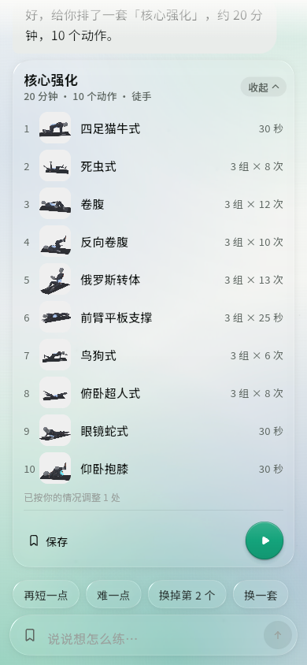
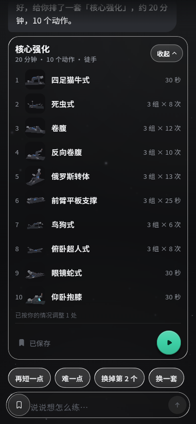

# PR #5 本机修复、复审与合并记录

2026-10-22（Asia/Shanghai）。[PR #5](https://github.com/mhgd3250905/Sport-Helper/pull/5) 的计划卡展开精简、共享元素过渡和动画优化已按开哥授权完成修复、通过复审并合入 main。GitHub 的 [APPROVED review](https://github.com/mhgd3250905/Sport-Helper/pull/5#pullrequestreview-5602560196) 绑定最终已测 head；没有使用管理员绕过。

## 固定版本

| 对象 | SHA / 结果 |
| --- | --- |
| 初审 PR head | `63c8720d5f3420954e594c717388ffa1bb49e052` |
| 合并前最新目标 main | `d4b3e76bf10474ae6c49d8b9f376fa842e16840b` |
| PR baseRefOid | 同上；另通过技能 inspect 直接查询目标分支 ref 核对最新值 |
| 原 PR 与目标的 merge-base | `7b1dd13e50c41511f20498a53d0bf4950e1c005f` |
| 修复、验证及批准 head | `f92cbc936a123b77bc43d2a23987d928596eaefd`；包含当前 main 的集成及两项修复、16 项新增测试 |
| GitHub 合并提交 | `172366c6527d999b7817d97fe386e442f70f0e20`；第一父提交为目标 main，第二父提交为上述 head |
| 文件树一致性 | 合并提交与已测 head 均为 `168e4b4cb2febc38f58b5edfdd4b72ff776532ce` |

验证在隔离工作副本 `Sport-Helper-pr5-review` 完成。相对当前 main，PR 最终只改变计划卡实现、原布局测试及新增可访问性测试，共 3 个文件；SDK、AI/存储实现、顶部栏及固定依赖均保留。结束前再次核对源/目标 SHA、OPEN/CLEAN/MERGEABLE 与 APPROVED 状态，再按已授权范围合并；合并后查询确认 MERGED，并把本地主线快进同步。随后只同步本记录、入口文档与截图。

## 两项 P2 及修复

1. **标题被收起按钮覆盖。** 原 `_Header` 固定预留 60px，实际按钮宽度随中文标签及字号变化。320px 屏幕、随包 NotoSansSC、长标题下，默认字号交叠 8.5px，1.3 倍为 16px，2 倍为 33.5px。修复后标题与唯一的收起按钮共用一个 `Row`，文字 `Expanded` 按按钮实际宽度让位；保留头部高度、飞图落点和逐帧动画时序。减少动效仍交叉淡入。
2. **隐藏详情按钮仍能被键盘激活。** 原 compact 的 `Offstage`、`IgnorePointer` 和 `ExcludeSemantics` 未阻止内部焦点，展开后 Tab 会停在看不见的按钮，Enter 仍跳入详情。现在 compact 在展开/收起途中隔离焦点，只有完全折叠后恢复；展开标题仅在动画完成后可聚焦/点击，折叠和中途反向的键盘路径一并覆盖。

独立代码复审没有剩余阻断项。原 550ms 展开 / 450ms 收起、首图变为第一个动作缩略图、其余缩略图飞入列表、保存/开始入口均保留。

## 验证证据

Windows，Flutter 3.44.7 / Dart 3.12.2。下列日志保存在主项目本机忽略目录 `.buildlog/pr5/`，不作为仓库 CI 记录。GitHub 当时没有 CI、分支保护或适用 ruleset；本机验证和已提交 review 单独记录。

| 检查 | 结果 / 日志 |
| --- | --- |
| `PUB_HOSTED_URL=https://pub.dev` 后 `flutter pub get --enforce-lockfile` | 通过，锁文件保持目标 main；`locked-pub.log` |
| `flutter test --no-pub --concurrency=1 --reporter expanded` | 全量 253 项通过；`final-tests.log` |
| 新增组件回归 | 16 项通过：320px、随包字体、1.0/1.3/2.0 字号 × 深浅色 × 普通/减少动效，以及 Tab/Enter、折叠和双向中途反向；详情、保存、开始回调正常。`final-accessibility-tests.log` |
| `flutter analyze --no-pub` | 0 issue；`final-analyze.log` |
| `flutter build web --no-pub --no-web-resources-cdn` | release 构建通过；`web-build.log` |
| `flutter build apk --debug --no-pub` | Android 编译通过；`android-debug-build.log`；没有安装或交付此验证包 |
| 正式 Web 入口 | 390×844、正式玻璃着色器；完成安全流程、模板生成、展开、保存、详情、切深色、进入共享播放器、暂停、提前结束并返回聊天。控制台 0 errors / 0 warnings |
| Git 校验 | `git diff --check` 通过；远端合并与文件树一致性已核对 |

全量测试后只调整新增测试的普通 import 写法，静态分析和该文件 16 项定向测试重新通过，生产代码未变。中途测试子进程曾按宿主镜像重新解析依赖；这次临时 lock 变化已撤回，再通过 pub.dev 严格锁文件恢复，最终全量与 Android 构建均使用原固定依赖。没有修改 SDK 或 pub 缓存源码。

## 实际画面与边界

| 浅色展开 | 深色展开 |
| --- | --- |
|  |  |

浏览器使用独立本地 origin 和本地模板，没有发送新 Worker 请求；Web 媒体使用既有海报替代层，不作为 Android 视频或声音验收。没有新增真机 TalkBack、帧率、发热或完整训练结论。

本轮 Android 包仅用于编译验证，未注入 Worker key、未替换此前交付包、未安装设备。默认版本仍为 `0.1.0+9`；先前 +9 和设备 +10 的身份保持原记录，它们不包含本次卡片改动。下次正式交付新包应按版本规则递增 versionCode 并记录实际产物身份。
